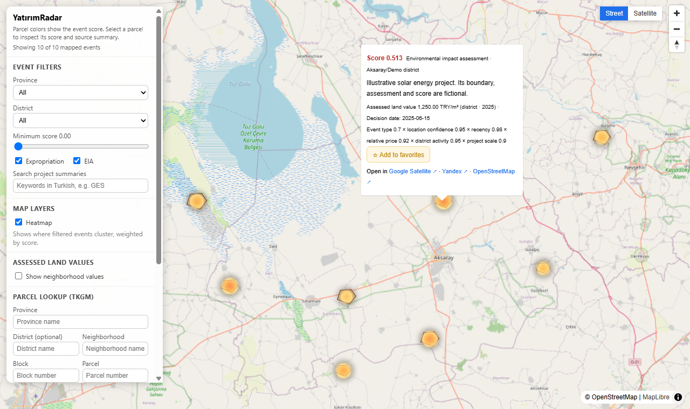

# YatırımRadar

YatırımRadar is a local research tool for following public decisions that affect land in Türkiye. It brings environmental impact assessment (EIA, or *ÇED*) decisions and urgent expropriation notices from the Official Gazette (*Resmî Gazete*) onto one map. You can see which decisions have been matched to a cadastral parcel, look up a parcel, and compare assessed land values by neighborhood and year.



*The map shows ten fictional decisions. The selected solar project shows its decision date, assessed land value and the factors behind its score. Basemap © [OpenStreetMap contributors](https://www.openstreetmap.org/copyright).*

## Run locally

From the repository root, use Python 3.12, uv and Docker Compose. The map and API run on your machine. The street and satellite basemaps require internet access.

```sh
uv sync --locked
docker compose up -d --wait
uv run alembic upgrade head
uv run yatirimradar serve
```

Open the [map](http://127.0.0.1:8000/) or the [interactive API documentation](http://127.0.0.1:8000/docs). The first run shows the basemap with empty data layers. To customize your database connection or import directories, copy `.env.example` to `.env` and edit the copy before starting the services.

## Add public decisions

Run these commands in a second terminal. The first two import archived and current EIA decisions for Ankara. The third scans one issue of the Official Gazette for urgent expropriation decisions.

```sh
uv run yatirimradar import-eia --province Ankara
uv run yatirimradar import-eia --current --province Ankara
uv run yatirimradar scan-gazette --date 2025-01-01
uv run yatirimradar status
```

The province summary counts decisions that have no parcel geometry. To map eligible decisions to cadastral parcels, run `uv run yatirimradar geocode-pending`. Parcel lookups use Türkiye’s General Directorate of Land Registry and Cadastre (TKGM) and are subject to its query quota.

## Import assessed land values

Put your own municipal assessment CSV files in `data/yerel/rayic/` and run `uv run yatirimradar import-assessments`. To import one file from another location, use `uv run yatirimradar import-assessments --csv PATH`. Set `RAYIC_DIZINI` to change the default directory.

This fictional row shows the expected column names and units. In order, the fields identify the province, district, neighborhood, street, value in Turkish lira per square meter, assessment year, source and price type. Use `rayic` for a municipal assessment and `ilan` for an advertised asking price.

```csv
il,ilce,mahalle,cadde_sokak,birim_fiyat_tl_m2,yil,kaynak,tip
Example Province,Example District,Example Neighborhood,Example Street,125.50,2025,example-schedule,rayic
```

The assessment panel groups records by neighborhood and year. Each group shows a record count, the source and the minimum, mean and maximum positive values in TRY/m². Neighborhoods without a reference point still appear in the list.

To place a neighborhood on the map, you can supply a local `data/seed/mahalle_noktalari.json` file. The top-level `bilgi_zamani` is the date and time the reference points became known, in ISO 8601 format with a time zone. Each entry in `noktalar` contains `il`, `ilce`, `mahalle`, `koordinat` (longitude, latitude) and `osm_node` (the source OpenStreetMap node ID). The marker represents the neighborhood as a whole.

## Rank and revisit decisions

```sh
uv run yatirimradar pipeline --no-fetch --province all
uv run yatirimradar score --province Ankara --top 10
uv run yatirimradar backtest --province Ankara --as-of 2025-01-01
```

The ranking combines event type, location confidence, recency, relative price, district event density and project size. It uses a neighborhood price where the match is reliable and falls back to a district price where available. The score helps prioritize decisions for investigation. Testing whether it predicts returns would require comparable observations of subsequent sale prices.

The pipeline saves its displayed ranking to `data/processed/tahminler/` with the information cutoff and the individual score factors. The `daily` command saves the top 20 nationwide. A historical backtest uses records the database already knew at the requested time. Importing older decisions today gives them a new ingestion timestamp.

## Development

```sh
uv run pytest
uv run ruff check .
uv run mypy src tests
```

Tests use synthetic inputs. The repository includes province reference coordinates. Local assessment files, raw responses, database backups, generated maps and environment settings are excluded from version control.
